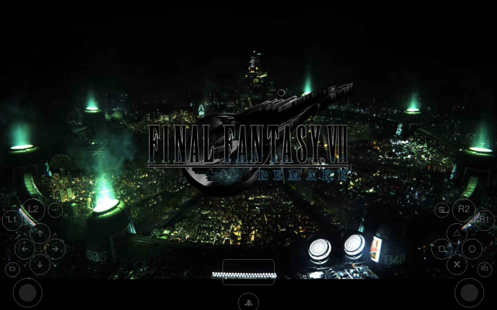
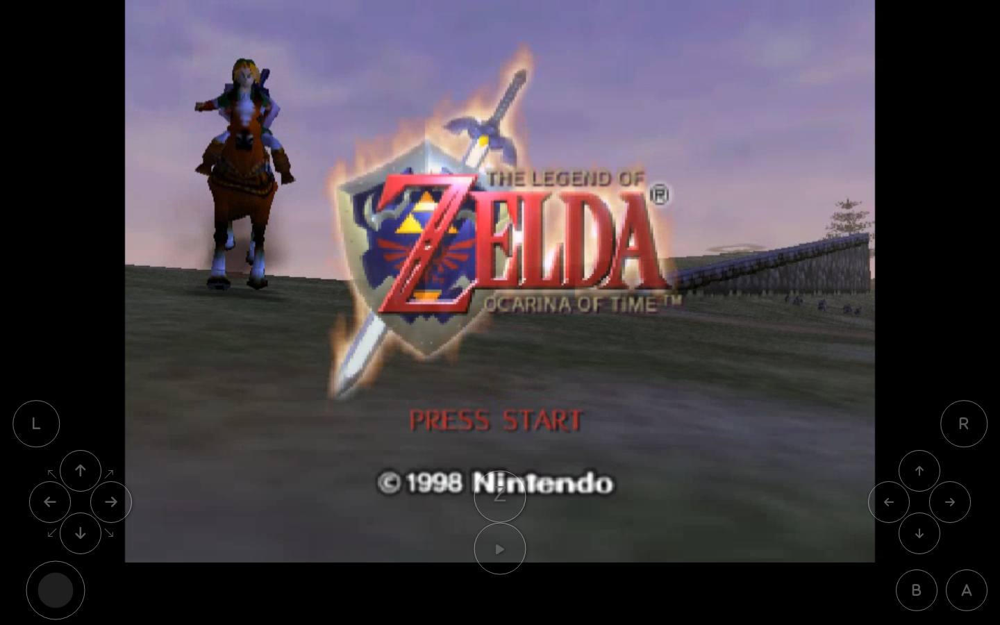
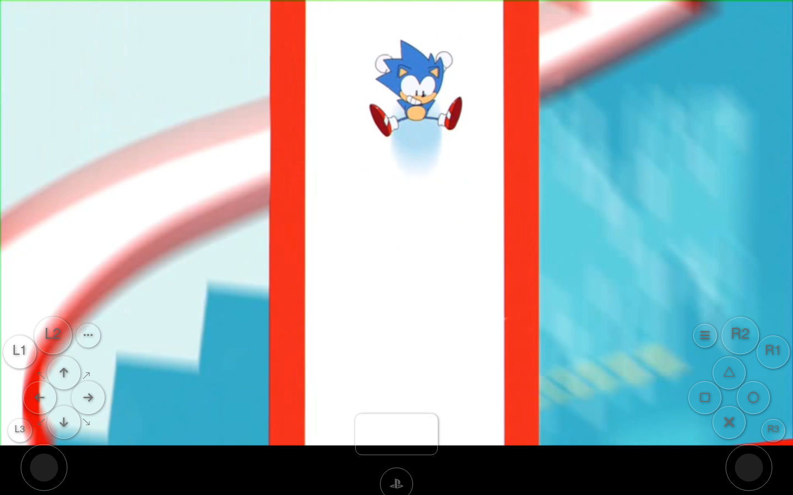
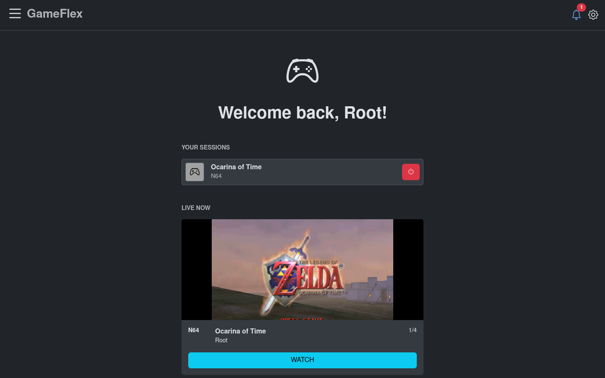
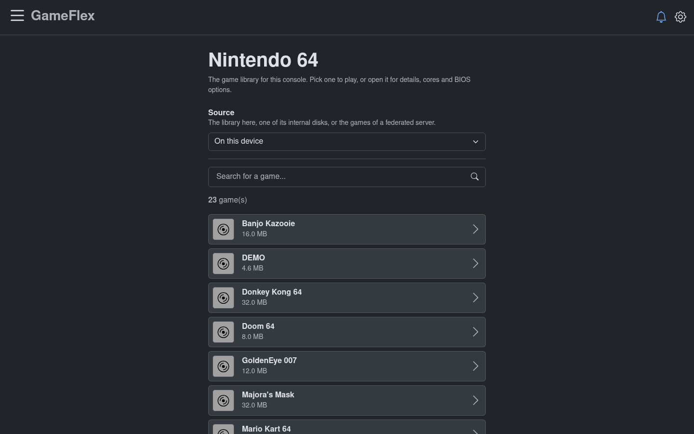
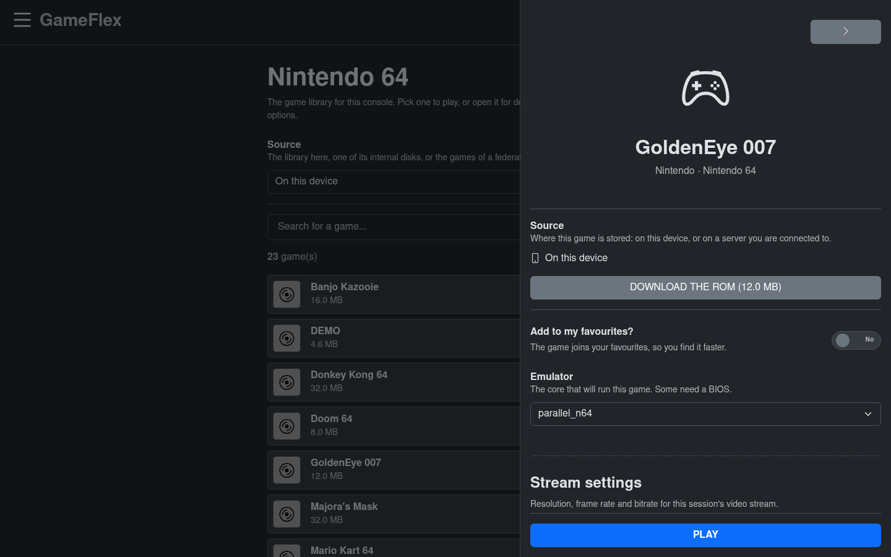
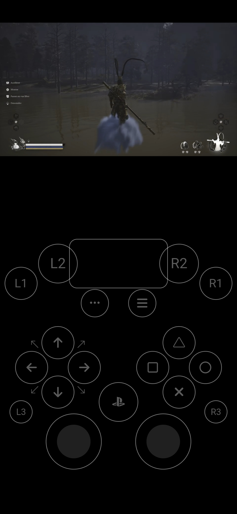
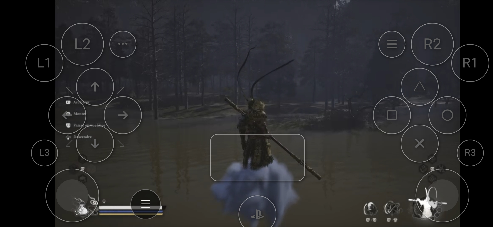

# GameFlex

**Self-hosted cloud gaming. Play anywhere, with anyone, on any device with a web browser.**

[](https://buymeacoffee.com/zinosaure)

> **GameFlex is still in development.** Expect bugs, rough edges and changes between versions,
> especially on the consoles marked *experimental*. It is a personal project, provided as is, with
> no warranty. Please read the [disclaimer](DISCLAIMER.md) before you install it.

GameFlex turns your own computer into a cloud gaming service. It runs the emulators at home and
streams the game, picture and sound, to whatever screen you have at hand: a phone, a tablet, a
laptop, a TV, a friend's computer. Your controller presses travel back the other way. There is
nothing to install to play: a web browser is enough, and an Android app is there if you prefer.

Because the screen in your hands only shows a video, it does not need to be powerful. A modest phone
plays a PlayStation 3 game, as long as the computer at home can run it.

No computer? A phone can be the server too: the [Android app](#the-android-app) runs a complete
GameFlex on the phone, which plays its own games and streams them to the screens around it.

### Play anywhere, on anything

- **Anywhere.** On your couch, in another room, or across the world: the same library, the same
  saves, wherever you are.
- **Away from home, without opening your server to the Internet.** GameFlex comes with an optional
  WireGuard VPN: your phone or laptop joins your home network from wherever it is, and only the
  devices you add can reach GameFlex.
- **On any device.** Windows, macOS, Linux, Android, iOS, a smart TV: if it has a modern web
  browser, it can play. A real controller, the on-screen controller (with buttons you place
  yourself), or the keyboard.
- **Fifty years of consoles in one place.** From the Atari 2600 to the PlayStation 5, behind one
  address, with the same accounts and the same saves.
- **Your real PS4 or PS5 too.** GameFlex connects to the console you own and brings it to your
  browser, wherever you are (Remote Play).

### Play together, even far apart

- **Online with friends, on games that never were.** Up to four controllers in the same game
  (eight on the Switch), each player on their own device, at home or at the other end of the
  world. A Super Nintendo party game becomes an online game.
- **Pass the controller.** Stuck on a level? Lend your controller to a friend who is watching and
  take it back when they are done, or give them your place for good. Someone watching can ask
  for the controller. It all works from a distance.
- **Anyone can watch.** Send a link: friends watch your game live in their browser, without an
  account. The home page shows the games being played right now, ready to watch or join, and
  members you invite get a notification.
- **No Internet needed with the phone.** The [Android app](docs/android.md) turns a phone into the
  console: friends nearby open its address in their browser and play with you, over the same
  Wi-Fi. On a train or a plane, the phone can share its own hotspot.

### Share with friends

- **Each other's games.** Connect two GameFlex servers and each of you sees the other's games. Copy
  them, or play them on your friend's machine, which does the work and streams the game to you
  ([federation](docs/federation.md)).
- **Emulators, BIOS files and settings.** A friend's server is also where you find the emulator
  versions, firmware, patches and emulator settings they use.
- **Your PlayStation, too.** Let a friend play your PS4 or PS5 through your server.

### Never lose your progress

- **Saves follow you.** Your saves belong to your account, on every device. On the retro consoles,
  quit a game with a save state and pick it up later, from the same point, on another screen.
  Back up a game's saves, or send them to a friend's server and fetch them back. Not yet
  implemented for the Xbox 360.
- **Rewind and fast forward** on the retro consoles: step back through the last 20 seconds, or run
  the game four times faster.
- **Cheat codes** on the retro consoles (Game Genie, Action Replay, GameShark…), kept with your
  account for each game.
- **Your games stay yours.** Your library is a folder on your own disk. There is no online catalog,
  no subscription, and no account with us.

| | |
|---|---|
|  |  |
|  |  |
|  |  |
|  |  |

## What it can play

| | Consoles |
|---|---|
| **Retro** | NES, Super Nintendo, Game Boy and Game Boy Color, Game Boy Advance, Virtual Boy, Nintendo 64, Nintendo DS, GameCube, Wii, Master System, Mega Drive / Genesis, Saturn, Dreamcast, PlayStation, PlayStation 2, PSP, Neo Geo, Neo Geo Pocket, Capcom CPS-1 and CPS-2, PC Engine, PC-FX, Atari 2600, 7800, Lynx and Jaguar, WonderSwan, ColecoVision, Vectrex, Commodore 64, Amstrad CPC, ZX Spectrum, Doom |
| **Recent, with Streamex** | PlayStation 3, Xbox, and, still experimental, PlayStation 4, PlayStation 5, Nintendo Switch, Wii U and Xbox 360 |
| **Remote Play** | your own PlayStation 4 or PlayStation 5 |

The full list, with the files each console needs, is in [Consoles](docs/consoles.md).

Retro consoles run on [libretro](https://www.libretro.com) cores. Recent consoles run on their own
Linux emulators: RPCS3, xemu, shadPS4, KytyPS5, Eden, Citron, Cemu and Xenia Canary.

**Streamex** is what plays them: GameFlex's own engine for the recent consoles, the same skeleton in
every console's image. It starts the console's emulator, captures its picture and sound, encodes the
video on your graphics card and streams it all to the players' browsers. Their controllers come
back as virtual controllers that the emulator takes for its own. A new console is a new emulator in
the same skeleton.

## Good to know before you start

- **GameFlex ships no game, no BIOS and no emulator.** It plays the files you put in your library.
- **All you need to install is Docker,** with Compose, on an x86-64 computer. A recent graphics card
  is recommended for the recent consoles. [Install GameFlex](docs/install.md) lists what you need.
- **It is made for your home network.** To play away from home, turn on its WireGuard VPN, or put
  GameFlex behind an HTTPS proxy ([Play away from home](docs/remote-access.md)). Without the VPN,
  some networks block the video: GameFlex does not include a relay (TURN) server yet.
- **The administrator password is yours.** GameFlex refuses to start without it; the setup
  script can make one up and shows it to you once.
- **It is still in development, a personal project with no warranty.** Read the
  [disclaimer](DISCLAIMER.md).

## What has been tested

GameFlex is tested on one setup so far. What follows has been seen working there; anything else
should work, but has not been tried.

- **The server:** a Linux PC with an AMD Ryzen 7 255 and its Radeon 780M graphics, which encode
  the video (VA-API). NVIDIA and Intel graphics have not been tried, nor Windows and macOS (Docker
  Desktop).
- **The browser:** Google Chrome, on Linux and on Android.
- **Recent consoles,** a few games each, played past their title screen: PlayStation 3 (Final
  Fantasy XIII), PlayStation 4 (Sonic Mania Plus), PlayStation 5 (Final Fantasy VII Remake,
  Richman 11), Switch (Mini Metro, EA Sports FC 27), Wii U (New Super Mario Bros. U, as a disc
  image and extracted), Xbox (Dead or Alive 3), Xbox 360 (Halo 3). Every game is different: see
  the known limitations in [Consoles](docs/consoles.md).
- **Remote Play:** with a PlayStation 5 (Black Myth: Wukong), from a phone. The PlayStation 4 has
  not been tried: we have none.
- **A friend's server (federation):** Final Fantasy VII Remake in 720p, played smoothly from a phone
  on mobile data.
- **The WireGuard VPN:** a retro game played through it, from a client on the same computer. Not
  yet from a phone on mobile data.
- **The Android app:** on a Samsung Galaxy S25 (Snapdragon 8 Elite, Adreno 830 graphics, 12 GB of
  RAM). The recent consoles on the phone need a Snapdragon (Adreno) graphics chip. PlayStation 4 and
  PlayStation 5 games start and play on the S25 itself — Sonic Mania Plus and Kingdom Hearts III
  (PS4), Richman 11 (PS5) — but this is not finished: they run well below full speed, and none has
  been played through.
- **Not tried yet:** playing with friends over the phone's own hotspot, without Internet.

## Quick start

On a computer with Docker:

```bash
mkdir ~/gameflex && cd ~/gameflex
curl -fLO https://raw.githubusercontent.com/zinosaure/gameflex/main/launch.sh
chmod +x launch.sh
./launch.sh
```

The script asks a few questions, then starts GameFlex and tells you which address to open. The
details, and the way to do it by hand, are in [Install GameFlex](docs/install.md).

**Installing with an AI agent?** Point it to [AGENTS.md](AGENTS.md): it explains how to install,
check, troubleshoot and report an issue on your behalf, and what to ask you first.

## Guides

1. [Install GameFlex](docs/install.md): the compose file to copy, its settings, volumes and ports.
2. [Organize your library](docs/library.md): where your games, BIOS files and emulators go.
3. [Consoles](docs/consoles.md): every console, the game formats it accepts, and the files it needs.
4. [GameFlex on Android](docs/android.md): the app, playing on the phone, and the phone as a server
   for your friends.
5. [Controllers and playing together](docs/controllers.md): the on-screen controller, real
   controllers, the keyboard, and sharing a game.
6. [Play away from home](docs/remote-access.md): the WireGuard VPN, or an HTTPS proxy and the
   router, and keeping it safe.
7. [Remote Play](docs/remote-play.md): your own PS4 or PS5.
8. [Share with friends: federation](docs/federation.md): give a friend access to your server, add
   theirs, copy their games or play them on their server, step by step with screenshots.
9. [Emulator settings](docs/emulator-settings.md): tune the recent consoles' emulators, keep and
   share presets.
10. [Storage](docs/storage.md): more disks, network shares, saves, cache and logs.
11. [Update GameFlex](docs/update.md): new versions, and going back.
12. [Troubleshooting](docs/troubleshooting.md): find what goes wrong, and report it.

## The Android app

The GameFlex app turns an Android phone or tablet into a GameFlex of its own:

- **It plays on the phone itself:** retro consoles on most phones, and, on a powerful one, recent
  consoles too.
- **It becomes a server for the people around you.** Friends on the same Wi-Fi open the phone's
  address in their browser, and play with you or watch. Nothing to install for them.
- **It connects to your GameFlex server**, to play its games from anywhere.

Download the latest `gameflex.apk` from the
[Releases page](https://github.com/zinosaure/gameflex/releases/latest). The app checks the same
page for updates and installs them itself. Everything else is in
[GameFlex on Android](docs/android.md).

## Source code

Most of GameFlex is open source, in this repository, under the [MIT License](LICENSE):

- **the services:** the kernel that runs the sessions (`src/microservices/kernel/`), the accounts
  service (`kernel/extras/credential/`), the retro engine (`runtimes/retrogaming/`), the front
  server (`edge/`) and the modules they share (`shared/`);
- **the web interface** (`src/webapp/`);
- **the console recipes:** each recent console's Dockerfile, entry point and settings
  (`runtimes/streamex/consoles/`, `profiles/`);
- **our emulator builds:** the patches and build scripts for shadPS4, KytyPS5, Eden and Box64
  (`tools/`). Those patches are under the license of the emulator they change.

A few parts are only published as binaries, under the [GameFlex binary license](LICENSE-BINARIES.md):
the video gateway, Remote Play, streamex (the program that runs and streams the recent consoles)
and the Android app. They are free to use and to redistribute unmodified.

**Rebuild the images yourself.** Check out the tag of a version, then:

```bash
GAMEFLEX_VERSION=x.y.z docker compose -f docker-compose.build.yml build
```

The open services build from this repository; the closed binaries come from the images published
for the same version. The rebuilt images take the names that `docker-compose.yml` runs. To start
them, set `GAMEFLEX_VERSION=x.y.z` in `.env`, then run `docker compose up -d`: `./launch.sh` and
`./launch.sh update` download the published images again, over yours. The details are at the top
of [docker-compose.build.yml](docker-compose.build.yml).

**Contribute.** Pull requests on the open part are welcome: [CONTRIBUTING.md](CONTRIBUTING.md) says
how they travel to a release.

## Where to find emulators and BIOS files

GameFlex ships none of them, but you can find them here. None of these sites is part of GameFlex,
and what you download from them is your responsibility.

- **Retro cores:** the [libretro buildbot](https://buildbot.libretro.com/). GameFlex downloads the
  cores it needs from there for you, from **Settings › Emulators**.
- **BIOS and firmware:** [RetroBIOS](https://abdess.github.io/retrobios/). Use the files from its
  RetroArch pack, under the names listed in [Consoles](docs/consoles.md).
- **Emulators for the recent consoles:** GameFlex downloads them for you too, from each emulator's
  publisher, in **Settings › Emulators**. Each one's website is linked from
  [Consoles](docs/consoles.md).
- **All of the above, laid out like a GameFlex library:** the mirror below.

### The mirror

You can find a mirror with recent emulator builds, firmware, patches and emulator settings, laid
out like a GameFlex library:

- **Address:** <https://gameflex-cdn.skino.app>
- **User name:** `gameflex`
- **Password:** `gameflex`

Download what you need and put it in the same folder of your library. To copy all of it, or one
part, at once: take `gameflex-mirror.py` from its root and give it your library folder (Python 3.9
or newer, nothing to install). Run it again later: it only downloads what changed.

```bash
python3 gameflex-mirror.py /path/to/your/library                  # everything (about 6 GB)
python3 gameflex-mirror.py /path/to/your/library --only cores/ps4  # one part
```

Its `src/` folder says where the source of each emulator file is: the exact upstream revision, and
for the builds we patch (shadPS4, KytyPS5, Eden, Box64 on the phone), our patches and build scripts.

To show this link in GameFlex's settings, set `GAMEFLEX_MIRROR_URL` to its address. The mirror is
not part of GameFlex: it can change or disappear.

## Thanks

GameFlex stands on the work of the emulation community. It runs these emulators, each under its own
license; none of these projects is associated with GameFlex.

- [libretro](https://github.com/libretro) and its cores, for the retro consoles: FCEUmm, Nestopia,
  Snes9x, Gambatte, mGBA, ParaLLEl N64, DeSmuME, Dolphin, Genesis Plus GX,
  PicoDrive, Yabause, Kronos, Flycast, PCSX ReARMed, PCSX2 (LRPS2), PPSSPP, Stella, ProSystem, Handy,
  Virtual Jaguar, the Beetle (Mednafen) cores, FinalBurn Alpha, Gearcoleco, vecx, VICE, Caprice32,
  Fuse and PrBoom.
- [RPCS3](https://github.com/RPCS3/rpcs3), for the PlayStation 3.
- [shadPS4](https://github.com/shadps4-emu/shadPS4), for the PlayStation 4.
- [KytyPS5](https://github.com/KytyPS5/KytyPS5), for the PlayStation 5.
- [Eden](https://eden-emu.dev) and [Citron](https://github.com/citron-neo/emulator), for the
  Nintendo Switch.
- [Cemu](https://github.com/cemu-project/Cemu), for the Wii U.
- [xemu](https://github.com/xemu-project/xemu), for the Xbox.
- [Xenia Canary](https://github.com/xenia-canary/xenia-canary), for the Xbox 360.
- [Box64](https://github.com/ptitSeb/box64), which runs the recent consoles' emulators on Android
  phones.
- [Pion](https://github.com/pion/webrtc), the WebRTC library that carries the video.

## Help and feedback

Issues are welcome: bug reports, games that don't work, ideas. Open one on the
[issues page](https://github.com/zinosaure/gameflex/issues/new/choose) and pick the form that fits:

- **Bug report:** something in GameFlex does not work as it should.
- **A game or a console does not work:** a game does not appear, does not start, or plays wrong.
- **Idea or request:** something GameFlex could do.

The bug and game forms ask for what helps us find the cause: your GameFlex version, where it happens (browser,
app or server), what you saw, and the logs (`./launch.sh logs kernel`, or **Settings › Logs**).
Screenshots help too.

Please never paste a password, your `.env` file or a token, and never share games, BIOS files or
links to them. A security problem goes through [SECURITY.md](SECURITY.md), not a public issue.

## Support GameFlex

GameFlex is a personal project, built in spare time. If you enjoy it and want to support its
development, you can buy me a coffee:

<a href="https://buymeacoffee.com/zinosaure"></a>

## License

GameFlex's source code is released under the [MIT License](LICENSE). The parts published only as
binaries (the video gateway, Remote Play, streamex and the Android app) are under the
[GameFlex binary license](LICENSE-BINARIES.md): free to use and to redistribute unmodified, not for
sale. Versions 0.3.0 to 0.8.0 were published under the MIT License alone, and remain so.

The Docker images and the Android app also contain software by others, each part under its own
license: see [THIRD-PARTY-NOTICES.md](THIRD-PARTY-NOTICES.md), and the full texts in
[THIRD-PARTY-LICENSES.txt](THIRD-PARTY-LICENSES.txt). GameFlex is not affiliated with any console
maker or game publisher. See the [disclaimer](DISCLAIMER.md).
