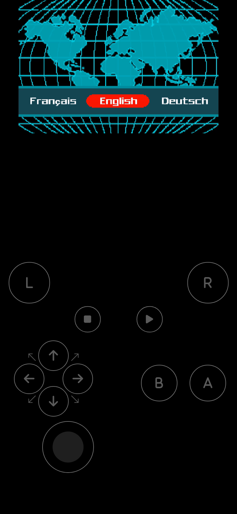

# GameFlex on Android

The GameFlex app turns an Android phone or tablet into two things at once:

- **A GameFlex of its own.** The phone keeps a library, runs the emulators itself, and plays your
  games without any computer. Retro consoles run on most phones; recent consoles need a powerful
  one.
- **A server for the people around you.** While the app runs, the phone serves GameFlex on your
  Wi-Fi. Friends open its address in their browser, on their own phone, tablet or computer, and
  play with you or watch. Nothing to install for them.

It also connects to your GameFlex server at home, to play its games and get its emulators.

## What you need

- **Android 8.0 or later, 64-bit.**
- **For the recent consoles** (PlayStation 3 to 5, Switch, Wii U, Xbox): a phone with a Qualcomm
  Snapdragon chip (Adreno graphics) and plenty of memory. On other phones they run far too slowly:
  play them from your GameFlex server instead.
- **Space for your games**, on the phone, an SD card or a USB key.
- Optional: a Bluetooth or USB controller.

## Install the app

1. Download `gameflex.apk` from the
   [Releases page](https://github.com/zinosaure/gameflex/releases/latest), on the phone.
2. Open it. Android asks, the first time, to allow installing apps from your browser or file
   manager: allow it.
3. Open GameFlex. It asks for two permissions:
   - **notifications**, to show that the server is running;
   - **access to all files**, to read the games in your library. Without it the library stays
     empty.

The app updates itself: on the home screen, **Update** › **Check for an update**.

## The home screen

The app opens on its home screen, in English, or in French on a phone set to French.

| Section | What it does |
|---|---|
| **Server** | Shows whether the phone's server runs, and stops or restarts it. **Stop the game** ends the game in progress. |
| **Update** | Installs the latest version of the app. |
| **Storage** | Where your library is, and how much space is left. **Change location** uses another folder: accounts, saves and logs are copied there; games, BIOS files and cores are not. |
| **Internal disks** | SD cards and USB keys with games. **Add a disk**. |
| **Accounts** | **Root password** makes a new administrator password. |
| **Join on the network** | **Share**: the phone's address, as a QR code and a link, for the people who join you. **Join**: open another GameFlex in the app, by its QR code or its link. |
| **Launch the app** | **Open** opens GameFlex itself: your games, your settings. |

## First start

1. In **Accounts**, press **Root password**, then **Generate**
  . Copy the password shown: it is shown only once.
2. Press **Open** and sign in as `root` with this password.
3. In **Settings › Members**, create your own administrator account, and accounts for the people
   who will play with you.

## Put your games on the phone

Your library is the `gameflex` folder of the phone's storage, unless you chose another place in
**Storage**. It is organized like on a server: `roms/<console>/` for the games,
`bios/<console>/` for the BIOS files. See [Organize your library](library.md) and
[Consoles](consoles.md).

**Games on an SD card or a USB key:** on the home screen, **Add a disk**,
pick the disk, and give it a name. The disk needs a `roms/` folder (or `bios/`, `cores/`…) laid out
the same way. A read-only disk, such as an NTFS USB key, works: GameFlex never writes to it, except
to delete a game you ask it to.

You can also read games from a **Samba share, a WebDAV server or kDrive**: **Settings › Remote
resources**. Their games are copied to the phone when you play them.

## Get the emulators

In GameFlex, open **Settings › Emulators**:

- **Retro consoles:** find the core marked *missing*, and download it. It comes from the
  [libretro buildbot](https://buildbot.libretro.com/), or from your GameFlex server if you added
  one.
- **Recent consoles:** choose your GameFlex server as the source, then download the console's
  emulator. It is the version for phones of the same emulator your server uses.

**Play** stays greyed out while a console's emulator is missing.

## Play on the phone

Open a game and press **Play**.

- **The on-screen controller** appears on the touchscreen. It hides when you connect a Bluetooth or
  USB controller; map your controller in **Settings › Controllers and devices**.
- **The game menu:** the button at the bottom left, or, on a controller, hold **L2**, then press
  **Home**, for a second.
- **A controller that clips onto the phone:** in **Settings › Application settings › Screen
  orientation**, choose **Portrait, half screen**. The game fills the top half, above the
  controller.

## Play together: your phone as the server

While the app runs, other devices on **the same Wi-Fi** can join the games of your phone.

**To invite someone to a game:**

1. Start the game on your phone.
2. Open the game menu, then **Share this session** › **Send link** (or **Copy link**).
3. Your friend opens the link in a browser. They arrive as a spectator, with no account needed,
   and press **Request to take control** to play. You accept from your phone.

**To let someone use GameFlex on their own device:** create an account for them in **Settings ›
Members**. They open the address shown under **Join on the network** › **Share**, such as
`http://192.168.1.40:10200`, or scan its QR code, and sign in. They can then join or watch the
games in progress from the dashboard.

**If they have the app too**, they join from it rather than from a browser: on their home screen,
**Join on the network** › **Join**, then **Scan a QR code** (Google's reader, which needs Google
Play services and installs itself the first time), or type the link and press **Join**. The app
checks that a GameFlex answers there, then opens it: they play under their account on your phone,
as in a browser. To come back to their own home screen: the Back button, or **Settings › Back to
the app's home screen**. The servers they joined stay listed under **Servers you joined**; **Open**
brings back their own GameFlex. Someone without the app, or with an iPhone, scans the same QR code
with the camera and joins in the browser.

Good to know:

- **Only an administrator starts a game** on the phone, and one game runs at a time. The others
  join it: the number of players depends on the console.
- **Sound for the others:** the first time someone joins from another device, Android asks you to
  allow screen recording. Allow it, or they hear nothing.
- **The phone keeps serving with the screen off.** A notification, *GameFlex — server*, shows it
  runs; its **Stop** button stops everything.
- **Use a network you trust.** On your Wi-Fi, anyone can read the list of your games and their
  files from the phone, without an account.

## Connect to your GameFlex server

1. On your server, create an access token for your phone (**Settings › Federations**).
2. On the phone, open **Settings › Federations › Add a server**. Fill in its **URL** and the
   **Access token**, press **Test**, then save.

The server's games appear in your catalog. **Play at <server>** plays them on the server, which
streams them to the phone; the first time, paste your account token from the server (**Settings ›
Profile** over there). You can also copy a game to the phone, to play it without the server.

## Remote Play: your PS4 or PS5

The phone connects to your own PlayStation 4 or 5 on the same network. Open **Remote Play ›
Add a console**, and follow the steps: the console's address (or **Discover consoles on the
network**), your PSN ID (**Get via PSN Login**), and the PIN code the console shows when you
choose, in its Remote Play settings, to add (link) a device. Then **Turn on** and **Play**.

## Known limitations

- The Xbox 360 is not available on the phone: play it from your GameFlex server.
- The recent consoles are experimental on the phone, and need a Snapdragon phone.
