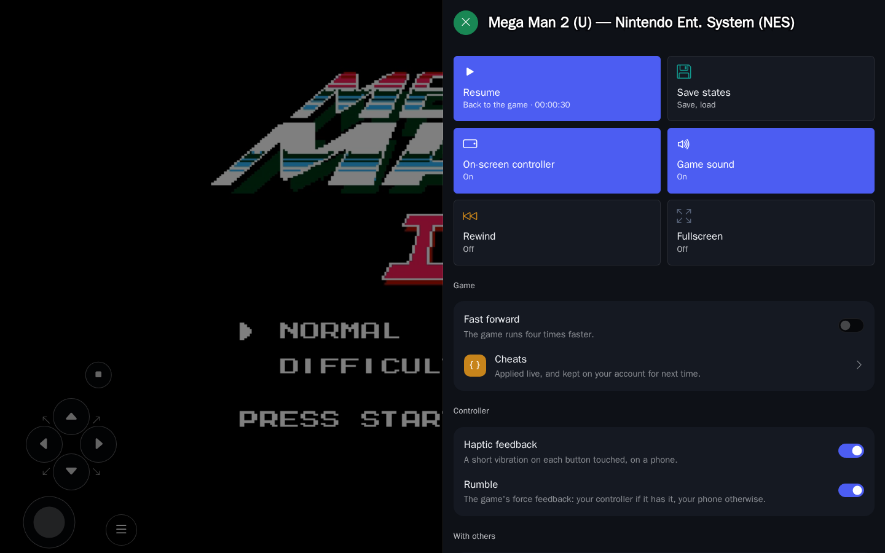

# Controllers and playing together

**Goal:** play with the on-screen controller, a real controller or the keyboard, and share a game
with other players.

## The on-screen controller

GameFlex shows a controller over the game, shaped like the console's own. It hides as soon as you
connect a real controller, and comes back when you disconnect it.

- **Show or hide it:** the **On-screen controller** tile, in the game menu.
- **A short vibration on each button touched:** **Haptic feedback**, in the game menu or in
  **Settings › Gamepads** (phones only).
- **Sticks that follow your thumb:** touch anywhere below the controller's buttons, across the
  whole width of the screen and down to its bottom edge: that point becomes the stick's center, and
  the stick returns to its place when you lift your thumb. In landscape, this area also rises between
  the two groups of buttons. With two sticks, the left half is the left stick and the right half the
  right stick. The area follows the controller's buttons, including a layout you saved. A button you
  touch stays a button, and the game screen above the area still receives your touches.
- **Press a stick:** the small **L3** and **R3** buttons near the sticks (**LS** and **RS** on an Xbox
  controller), on the controllers whose console has them: PlayStation, Xbox and Switch.
- **Hide the sticks until you use them:** **Invisible sticks**, in the game menu or in **Settings › Gamepads**;
  it applies at once, even during a game. No stick is drawn at rest: a stick appears under your thumb
  and disappears when you lift it. **Edit the layout** always shows the sticks, so you can move them.
- **Move the buttons:** **Settings › Gamepads › Edit the layout**. Choose a button or a group
  (D-pad, action buttons, Start / Select, triggers), drag it where you want it, or set its **X**,
  **Y** and **Size**; the **Opacity**, from 1 to 100 %, applies to the whole controller, and can also be set from the
  game menu. Portrait and landscape keep
  their own positions: turn the device to edit the other one. Each controller keeps up to five
  layouts; **Use this layout** chooses the one used in game.

## A real controller

Connect a USB or Bluetooth controller: GameFlex maps it for you. It works in every game, as the
console's controller.

To change the buttons, open **Settings › Gamepads**:

1. In **Virtual controller**, choose the console controller you want to map, such as
   *PS1/2 (DualShock)* (shared by the PlayStation and PlayStation 2).
2. In **Controller**, choose your controller, or the keyboard. **Auto** applies the default buttons
   to every virtual controller.
3. Press A on a row to set it, then press the button, or several at once for a diagonal for
   example, and release.

The analog sticks keep their place. **Danger › Reset the buttons** brings this controller's buttons
back to the defaults. The settings are kept in this browser.

**Rumble:** **Rumble**, in the same screen or in the game menu. It works on controllers that
support it, and on the phone's own vibration otherwise.

**PlayStation:** the first PlayStation starts with its original digital pad, as most of its games
expect. For a game that needs the sticks, turn on **DualShock controller** in the game menu.

## The keyboard

On a computer, the keyboard works as a controller. The default keys, for the retro consoles:

| Keys | Buttons |
|---|---|
| Arrow keys | D-pad |
| Z, X, A, S | A, B, X, Y (on a PlayStation pad: Circle, Cross, Triangle, Square) |
| Q, W | L, R |
| E, R | L2, R2 |
| Enter | Start |
| Right Shift | Select |

Change them in **Settings › Gamepads**, with *Keyboard* as the controller.

## The game menu

- **Open it:** slide the menu button, at the bottom right of the screen, to the left; a simple touch
  does nothing, so a thumb on a stick never opens it by accident. While you play, the button fades
  to a faint outline and comes back at your next touch on the game screen. **Esc** on a keyboard,
  or, on a controller, hold **L2** and **Home** together for three seconds. While L2 is held, Home
  does not reach the game.
- **The tiles:** **Resume**, **Save states** (save the game in a slot, load it later), the
  **On-screen controller**, the **Game sound**, **Rewind** (retro consoles: step back through the
  last seconds) and **Fullscreen** (in a web browser; the Android app is always fullscreen).
- **Sound after a reload:** a web browser plays no sound on a page you have not touched yet — a
  game page you reload, or open from a link to watch. The page then shows **Tap the screen to turn
  on sound**, and the sound starts at your first touch, click or key press anywhere on it; a
  controller button does not count for the browser. The Android app plays it at once.
- **Game:** on a retro console, **Fast forward** (the game runs four times faster) and **Cheats**
  (Game Genie, Action Replay, GameShark…, kept on your account for each game); the **Disc** of a multi-disc game, and,
  on a recent console, **Type some text**, which types into the field the game has open, as a
  plugged-in keyboard would.
- **Controller:** **Haptic feedback**, **Invisible sticks** and **Opacity** while the on-screen
  controller shows, **Rumble**, and **DualShock controller** on the first PlayStation. They are the
  same settings as in **Settings › Gamepads**: a change in one place shows in the other. **Opacity**
  is the one of the layout used in game (**Edit the layout**); with no layout of your own, it keeps
  the default button positions.
- **With others:** inviting people and handing the controller over (see
  [Play together](#play-together)).
- **Picture and sound:** **Video**, the stream this screen receives (see below); **Orientation**
  (on a phone or a tablet), the same setting as **Settings › Application › Orientation**, applied at
  once without stopping the game; **On-screen
  stats**: **Compact view** shows the main figures in small type, **Statistics** shows the frame
  rate, the bitrate, the emulator and the machine's load; in the Android app, the phone's
  temperature and battery come first. **Send to the TV** sends the game to a Chromecast on the same
  network.
- **Leave:** **Reset the console** (the game starts over), and **Quit the game**, which asks what
  happens to it: **Quit and leave the game running**, **Quit and pause the game**, or **Quit and end
  the game** for everyone. On a retro console, **Save the state when leaving** keeps where you were.

Save states, rewind, fast forward, cheats, the disc and resetting the console belong to the player
who started the game.

## Picture quality

The picture quality is set on the game's page, before **Play**: the gear, then **Stream settings**
(**Resolution**, **Frame rate**, **Bitrate**). It is kept for each console, in this browser only: a
phone on mobile data and a computer at home have neither the same network nor the same power. By
default: 540p, 30 frames per second, and an automatic bitrate — at each launch, the browser
measures its throughput to the game's server and the picture takes a share of it, for the whole
game; a bitrate you choose stays fixed. **Detect the network** measures the latency and the
throughput to the server, and picks the resolution and the frame rate for you.

**When your network weakens**, the picture drops to the game's smaller stream, and goes back once
the network has been stable for about thirty seconds. Each screen follows its own network: a friend
on a weak connection does not lower the picture for the others. In the game menu, **Video** chooses
this screen's stream: **Automatic** (the default), or one of the game's streams. The thumbnails on
**Live** use the smaller stream. Some games have a single stream: the menu says so.

## Play together

How many players share a game depends on the console: four on the Super Nintendo, Nintendo 64,
GameCube, Wii, Mega Drive, Saturn, Dreamcast, PlayStation 1 to 5, Xbox and Xbox 360; eight on the
Switch; one on the PSP and in Remote Play; two on the others. Each one plays from their own device,
wherever they are.

**Join a game:** on **Live**, the first tab, press **Join** to play or **Watch** to look on. Inside
the game, **Take the controller** takes a free place.

**When all places are taken:** **Ask for the controller**, in the game menu, asks a player for
theirs. They answer from their screen: **Lend**, **Give my place**, or **Keep it**.

**Hand your controller over:**

- the player who started the game can **Lend my controller**: someone else plays, and **Take my
  controller back** returns it;
- the others can **Give my place** to someone who is watching.

**Invite people:**

- **Copy the link** (or **Send the link** on a phone), or the **QR code**, in the game menu: anyone
  with it can watch, even without an account; to play, they sign in.
- **Invite a member** sends a notification to a member of your GameFlex, which opens the game.

**Away from the controller:** after 29 minutes without a press, GameFlex asks whether you are still
there; without an answer (**I'm here**), the player loses the controller one minute later. A game
nobody plays stops after five minutes.

## If something goes wrong

| What you see | What to do |
|---|---|
| The controller does nothing | Press one of its buttons once: browsers only reveal a controller after its first press. Then check its buttons in **Settings › Gamepads**. |
| The buttons are swapped | Set them again, or choose **Auto** to apply the defaults. |
| A PlayStation game ignores the sticks | Turn on **DualShock controller** in the game menu. |
| The on-screen controller hides the game | Move or shrink its buttons with **Edit the layout**, or lower its **Opacity**. |
| No vibration | Turn on **Rumble**; not every controller or browser supports it. |
