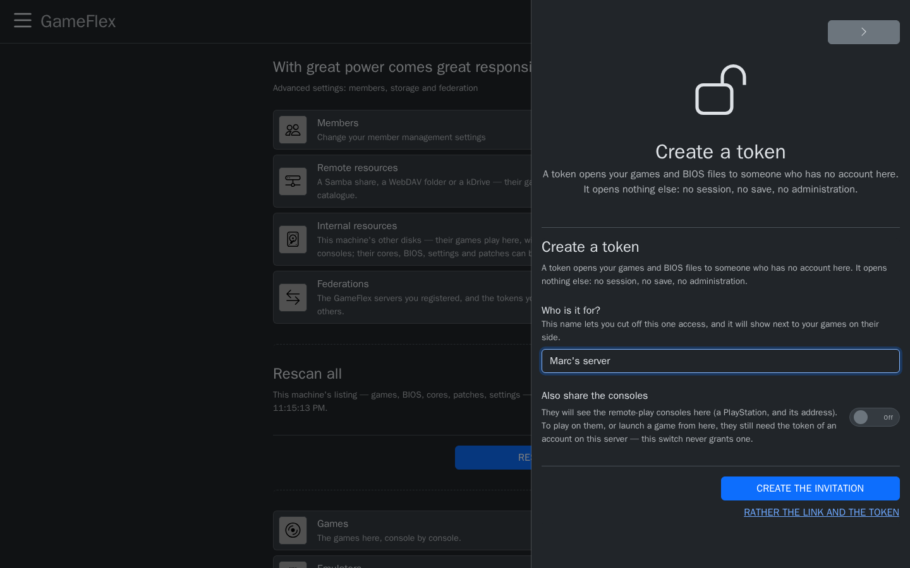
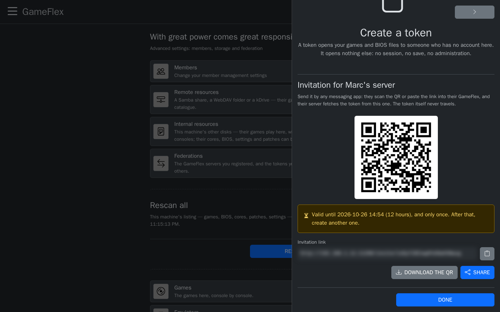
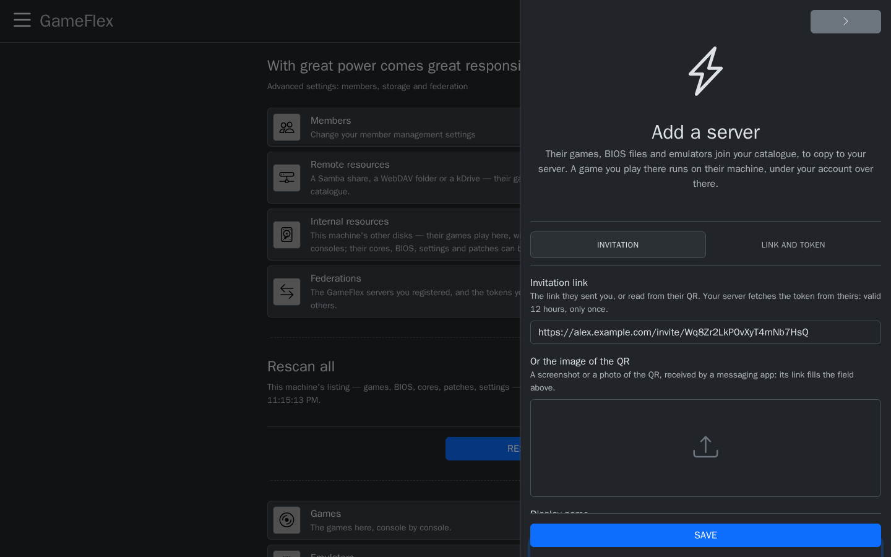
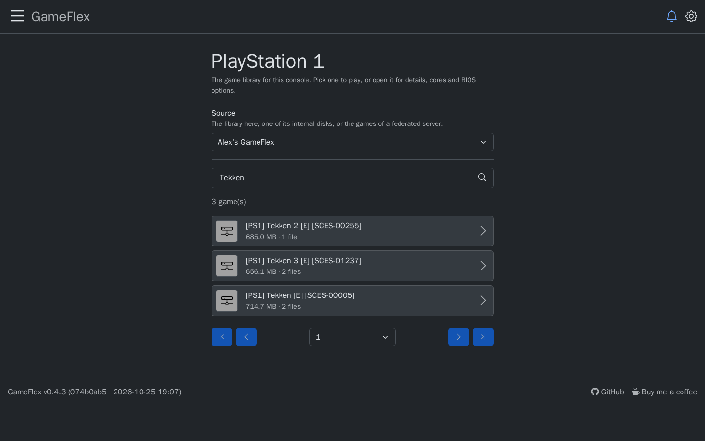
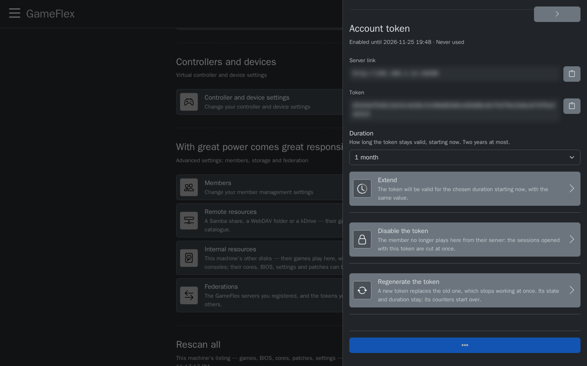
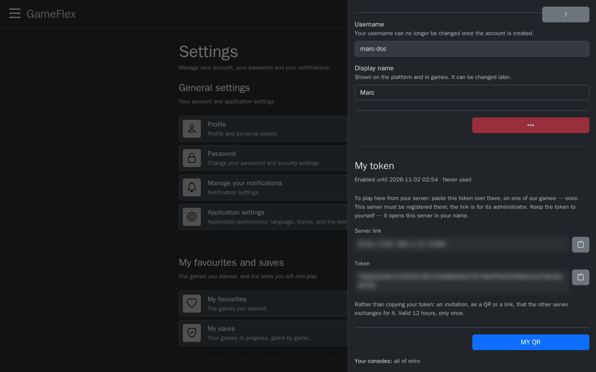
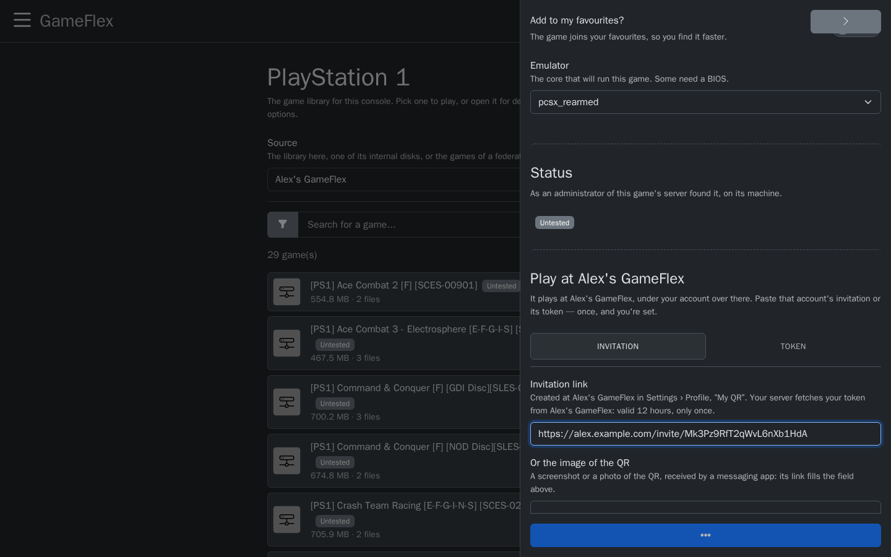
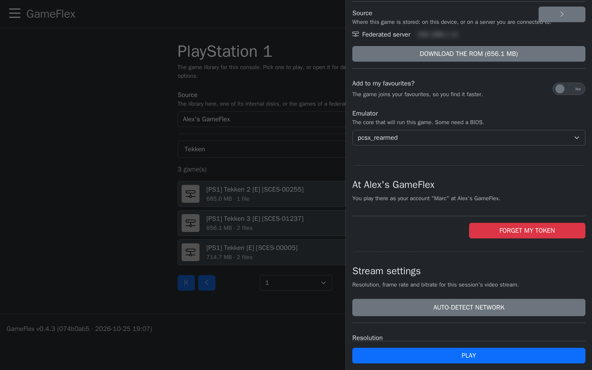
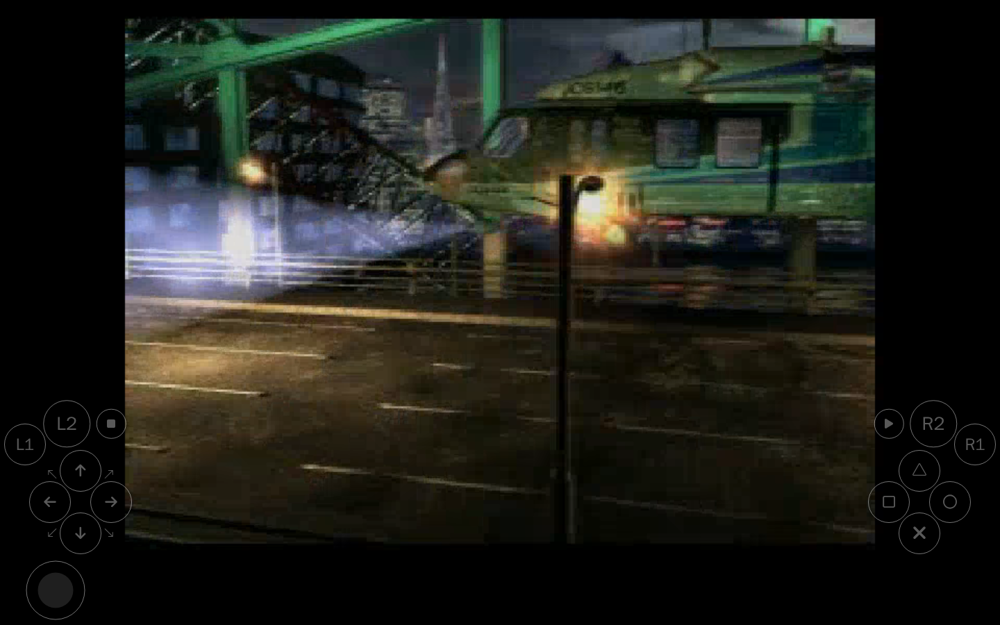

# Share with friends: federation

**Goal:** connect your GameFlex server with a friend's, so that each of you sees the other's
games, BIOS files, emulators, patches and emulator settings, copies what they need, and can play
on the other's server.

## How it works

- **Access goes through a token**, a long key that an administrator creates for one person. A token
  opens **only the catalog**: games, BIOS files, emulators, patches, emulator settings, and, if you
  choose, your Remote Play consoles. It opens no game session, no save and no administration.
- **You send an invitation, not the token.** An invitation is a link, also shown as a QR code,
  that works **once** and for **12 hours**. Your friend's server exchanges it with yours for the
  token, so the token itself never goes through a messaging app. The old way, sending the link and
  the token, still works.
- **Each side decides.** Your friend sees your catalog once you give them a token; you see theirs
  once they give you one. You can revoke a token at any time.
- **Nothing is replaced.** What you copy from a friend lands in your own library, and never over a
  file you already have.
- **Each administrator answers for what they share** and for what they take. See the
  [disclaimer](../DISCLAIMER.md).

**Before you start:**

- You are an administrator of your GameFlex.
- Your friend's server can be reached from yours: on the same network, or on the Internet behind
  an HTTPS proxy. To play on their server, the device you play on reaches it too, like any player
  away from home (see [Play away from home](remote-access.md)).

## Give a friend access to your server

1. Open GameFlex through the address your friend will use to reach it (its public HTTPS address,
   see [Play away from home](remote-access.md)): the **Server link** GameFlex gives is the address
   you opened. Then, in **Settings › Federations**, press **Generate a federation token**.
2. In **Who is it for?**, give a name you will recognize, such as *Marc's server*. It is shown next
   to your games on their side, and lets you cut off this access alone.
3. To also show them your Remote Play consoles, tick **Also share the consoles**.
4. Press **Create the invitation**.

   

5. GameFlex shows the invitation: a **QR code** and its **Invitation link**. Send it to your friend
   in a private message: **Download the QR** and send the image, **Share**, or copy the link. It
   works once, within 12 hours; after that, create another one.

   

Until your friend uses it, the invitation waits under **Pending invitations**, where you can revoke
it. Once used, it becomes a token of the list below it, with the name you gave.

**The old way:** press **Rather the link and the token** instead of **Create the invitation**.
GameFlex shows a **Server link** and a **Token**: send both, in a private message. The token is
shown only once: if it is lost, revoke it and create another.

## Add a friend's server

1. Ask your friend for an invitation (the steps above, on their side).
2. In **Settings › Federations**, press **Add a server**.
3. On the **Invitation** tab, paste the **Invitation link**, or choose the image of the QR (the one
   they sent you, or a screenshot of it): GameFlex reads it and fills in the link. A **Display name**
   is optional.
4. Press **Save**. Your server exchanges the invitation with theirs for a token, and checks it right
   away: their server joins the list, with its processor, memory and graphics card.

   

If they sent you a link and a token instead, fill them in on the **Link and token** tab.

Opened in a browser (by a phone camera, for example), an invitation link shows a page that says
where to paste it. Opening it uses nothing up.

## Use their catalog

**Their games.** On the games page of a console, choose their server in **Source**. Their games are
listed, and each one can be:

- **copied to your server:** in **Settings › Games**, choose their server as the source, then press
  the download button next to the game. It lands in your `roms/<console>/`, and plays here like your
  own games;
- **played on their server**, which streams it to you: see
  [Play on a friend's server](#play-on-a-friends-server).

**Their emulators, BIOS files, patches and settings.** In **Settings › Emulators**, **Firmware**,
**Patches** or **Emulator settings**, choose their server as the **Source**, then download what you
need. Emulator settings are imported as a preset of your own (see
[Emulator settings](emulator-settings.md)).

**The phone app** adds a server the same way, and installs the recent consoles' emulators from it
(see [GameFlex on Android](android.md)).

## Play on a friend's server

The game runs on your friend's machine, which streams it to you. It runs under **your account on
their server**: you need one there, and its token. You paste that token once per server; each
member of your GameFlex who wants to play there needs their own account over there.

**On your friend's side:**

1. In **Settings › Members**, they create an account for you, with the consoles you may play.
2. In that account, under **Account token**, they choose a **Duration** and press
   **Enable the token**.

   

**On your side:**

3. Sign in on your friend's GameFlex page with that account. In **Settings › Profile**, under
   **My token**, press **My QR**: GameFlex shows an invitation for your account, valid once within
   12 hours. Copy its link, or download or share its QR.

   

4. Back on your own GameFlex, open one of their games (their server chosen in **Source**). Under
   **Play at <their server>**, on the **Invitation** tab, paste the link or choose the image of the
   QR, then press **Use this invitation**. You can also copy the **Token** itself from their
   **Settings › Profile** and paste it on the **Token** tab.

   

5. The panel now says which account you play under over there. Press **Play**.

   

The game starts on their server and plays in your page, like any other game:

The token stays with your account here, on all your devices: every game of that server now starts
with **Play**. To play there under another account, press **Forget my token** in a game's panel.

## What you should see

- Their server appears in **Settings › Federations**, and in the **Source** lists.
- Their games show under their console, with their server's name.

GameFlex keeps a copy of their list. When they add games, press the refresh button next to
**Source** to fetch the new list.

## Stop sharing

- **Cut off a friend:** in **Settings › Federations**, find their token and press **Revoke**. Their
  server immediately loses access to yours. An invitation not used yet is revoked the same way,
  under **Pending invitations**.
- **Stop a friend playing on your server:** in **Settings › Members**, open their account and press
  **Disable the token**. The games they opened with it stop at once.
- **Remove a friend's server:** delete it from **Settings › Federations**. What you copied from it
  stays in your library.

## If something goes wrong

| What you see | What to check |
|---|---|
| *This address did not answer* | The URL, and that their server is reachable from yours (HTTPS proxy, firewall). |
| Their server refuses your token | The token was revoked or mistyped: ask for a new one. |
| *This invitation was already used, has expired or was revoked* | Ask for a new one: an invitation works once, within 12 hours. |
| *This invitation goes elsewhere* | A server invitation goes in **Add a server**, an account one in **Play at…**. It was not used up: paste it in the right place. |
| *The token of this account is disabled over there* | Ask your friend to enable the token of your account. The invitation was not used up. |
| *No QR could be read in this image* | Choose a sharper image, or paste the link instead. |
| *Too many refused invitations* | Wait a few minutes, then try again. |
| **Play at <their server>** refuses your account token | It was disabled, expired or regenerated: ask your friend to enable it again, then copy it from **Settings › Profile** on their GameFlex. |
| A game is listed but unavailable there | Your account on their server has no access to this console: they can grant it in **Settings › Members**. |
| A download says the file already exists | You already have one: delete yours first to take theirs. |
