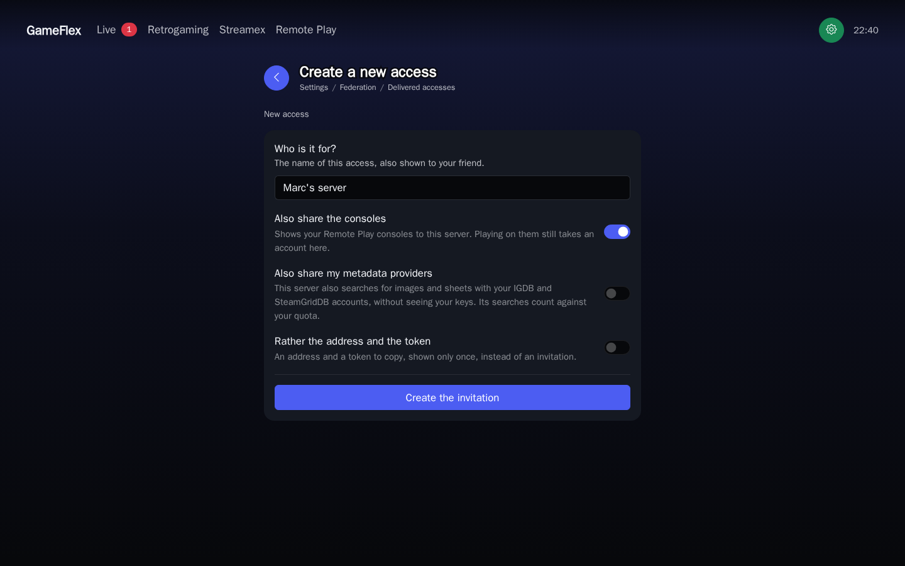
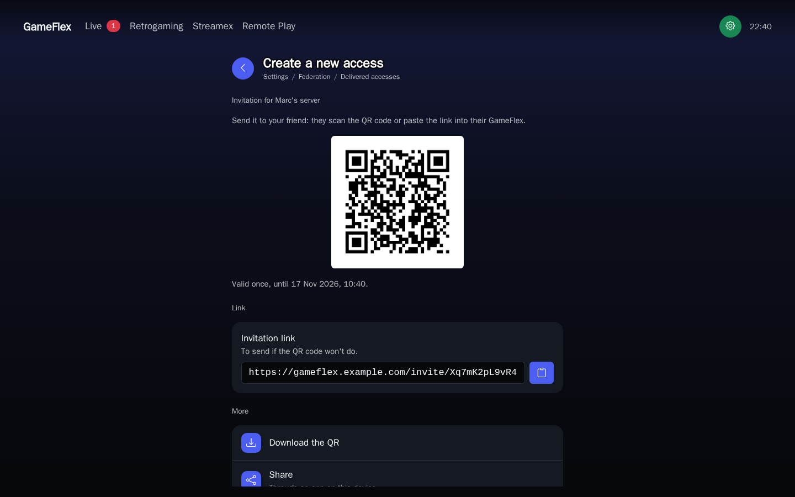
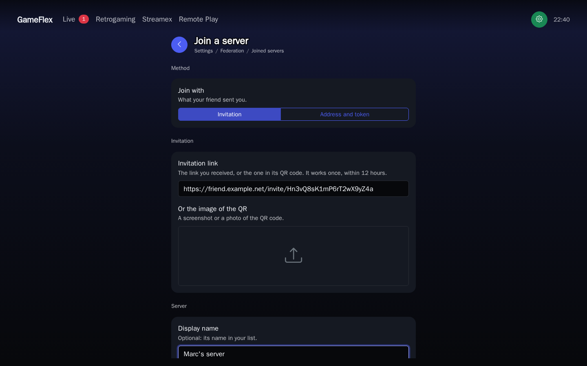
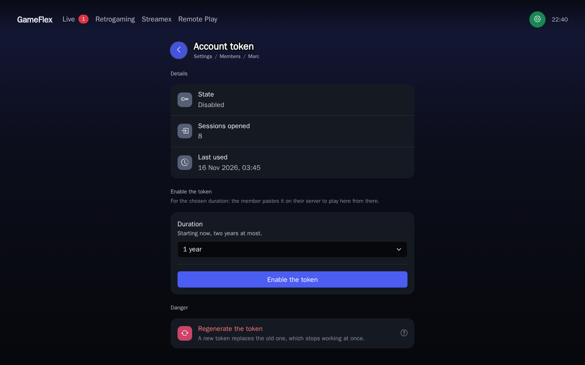
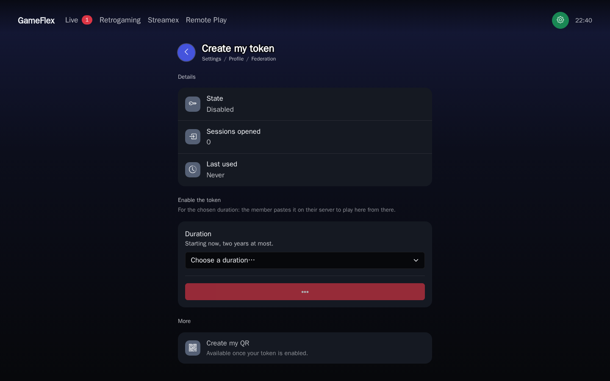

# Share with friends: federation

**Goal:** connect your GameFlex server with a friend's, so that each of you sees the other's
games, BIOS files, emulators, patches and emulator settings, copies what they need, and can play
on the other's server.

## How it works

- **Access goes through a token**, a long key that an administrator creates for one person. A token
  opens **only the catalog**: games, BIOS files, emulators, patches, emulator settings, and, if you
  choose, your Remote Play consoles. It opens no game session, no save and no administration.
- **You send an invitation, not the token.** An invitation is a link, also shown as a QR code,
  that works **once** and for **12 hours**. Your friend's server exchanges it with yours for the
  token, so the token itself never goes through a messaging app. The old way, sending the link and
  the token, still works.
- **Each side decides.** Your friend sees your catalog once you give them a token; you see theirs
  once they give you one. You can revoke a token at any time.
- **Nothing is replaced.** What you copy from a friend lands in your own library, and never over a
  file you already have.
- **Each administrator answers for what they share** and for what they take. See the
  [disclaimer](../DISCLAIMER.md).

## Federated servers and federated accounts

Two words come back on every federation page of GameFlex. They are not the same thing, and playing on
a friend's server takes both.

- **A federated server** is another GameFlex that an **administrator** connects to yours, in
  **Settings › Federation**. Either they add your friend's server here (**Joined servers › Join a
  server**, with the invitation or the token your friend created), or they give access to your own
  server (**Delivered accesses › Create a new access**). A federated
  server's games, BIOS files and emulators can then be **seen and downloaded** from here. Each
  administrator decides what their server opens, and can revoke it at any time.
- **A federated account** is **your own account on a federated server**: an account your friend
  created for you on their GameFlex, with the consoles you may play. You paste its token **once**, in
  **Settings › Profile › Federation › Sign in at federated servers**; it stays with your account
  here, on all your devices. It is what lets you **play** on that server. Each member signs in with
  their own account: an administrator does not do it for them.

**To play a game on a federated server, two accesses are needed:**

1. **The server opens the console to the federation**: its games of that console show on your side,
   because its administrator gave your server access.
2. **Your federated account allows that console**: you pasted a valid token of your account over
   there, and that account has the console (in **Settings › Members**, on their side).

If one of the two is missing, the game can be seen and downloaded, but not played there: every
console of a federated server needs your federated account.

**Settings › Federation** belongs to the administrator and only creates the connection between
servers; **Settings › Profile › Federation** belongs to each user, for their own token and their
federated accounts.

**Before you start:**

- You are an administrator of your GameFlex.
- Your friend's server can be reached from yours: on the same network, or on the Internet behind
  an HTTPS proxy. To play on their server, the device you play on reaches it too, like any player
  away from home (see [Play away from home](remote-access.md)).

## Give a friend access to your server

1. Open GameFlex through the address your friend will use to reach it (its public HTTPS address,
   see [Play away from home](remote-access.md)): the **Server address** GameFlex gives is the address
   you opened. Then, in **Settings › Federation › Delivered accesses**, open **Create a new access**.
2. In **Who is it for?**, give a name you will recognize, such as *Marc's server*. It is shown next
   to your games on their side, and lets you cut off this access alone.
3. To also show them your Remote Play consoles, turn on **Also share the consoles**. To let their
   searches for game sheets use your metadata provider accounts, turn on **Also share my metadata
   providers** (off by default: their searches count in your quota).
4. Press **Create the invitation**.

   

5. GameFlex shows the invitation: a **QR code** and its **Invitation link**. Send it to your friend
   in a private message: **Download the QR** and send the image, **Share**, or copy the link. It
   works once, within 12 hours; after that, create another one.

   

Until your friend uses it, the invitation waits under **Delivered accesses › Pending delivered
accesses**, where you can revoke it. Once used, it becomes one of the delivered accesses, with the
name you gave.

**The address and the token instead:** turn on **Rather the address and the token**, then press **Create
the token**. GameFlex shows a **Server address** and an **Access token**: send both, in a private
message. The token is shown only once: if it is lost, revoke it and create another.

## Add a friend's server

1. Ask your friend for an invitation (the steps above, on their side).
2. In **Settings › Federation › Joined servers**, open **Join a server**.
3. With **Join with** on **Invitation**, paste the **Invitation link**, or choose the image of the QR
   (the one they sent you, or a screenshot of it): GameFlex reads it and fills in the link. A
   **Display name** is optional.
4. Press **Save**. Your server exchanges the invitation with theirs for a token, and checks it right
   away: their server joins the list, with its processor, memory and graphics card.

   

If they sent you an address and a token instead, choose **Address and token** and fill them in.

The page of their server, in **Settings › Federation › Joined servers**, shows what it announced when
it was last read: its version, its machine, and what it shares with you.

Opened in a browser (by a phone camera, for example), an invitation link shows a page that says
where to paste it. Opening it uses nothing up.

## Use their catalog

**Their games.** Their games show in the library of each console, next to yours, with their
server's name. Each one can be:

- **copied to your server:** in **Settings › Consoles**, open the console, then **Games**, their
  server, and the game; press **Download into the library**. It lands in your `roms/<console>/`,
  with its sheet, and plays here like your own games. Games asked for one after the other **wait in
  a queue** and download one at a time: each shows its place, the one downloading its progress, and
  **Live** lists them all. **Remove from the queue** or **Cancel** stops one. The server keeps the
  queue: you can close the page;
- **its sheet alone copied to your server:** on the same page, **Download the metadata into the
  library** copies its texts and images into your metadata, without the game. The game, downloaded
  later, finds it;
- **played on their server**, which streams it to you: see
  [Play on a friend's server](#play-on-a-friends-server).

**Their emulators, BIOS files, patches and settings.** In **Settings › Consoles**, a console's
emulators, BIOS files and games' patches offer their server as a source to download from. Their
emulator settings show as presets in your settings form (see
[Emulator settings](emulator-settings.md)).

**The phone app** adds a server the same way, and installs the recent consoles' emulators from it
(see [GameFlex on Android](android.md)). It also shares its own games and Remote Play consoles like
a server: its **Delivered accesses**, its invitations and its pairing code work the same way, and its
discovery mode announces it on the local network. Its Remote Play consoles are open to anyone with a
valid account on the phone, as on a server; the games that run on the phone itself are started by its
owner only.

## Play on a friend's server

The game runs on your friend's machine, which streams it to you. It runs under **your account on
their server** — your federated account: you need one there, and its token. You paste that token
once per server; each member of your GameFlex who wants to play there needs their own account over
there (see [Federated servers and federated accounts](#federated-servers-and-federated-accounts)).

**On your friend's side:**

1. In **Settings › Members**, they create an account for you, with the consoles you may play.
2. In that account, under **Account token**, they choose a **Duration** and press
   **Enable the token**.

   

**On your side:**

3. Sign in on your friend's GameFlex page with that account. In **Settings › Profile ›
   Federation › Create my token**, open **Create my QR**: GameFlex shows an invitation for your
   account, valid once within 12 hours. Copy its link, or download or share its QR.

   

4. Back on your own GameFlex, in **Settings › Profile › Federation › Sign in at federated
   servers**, open their server. Under **Play at <their server>**, on the **Invitation** tab, paste
   the link or choose the image of the QR, then press **Use this invitation**. You can also copy the
   **Token** itself from their **Create my token** page and paste it on the **Token** tab. The same
   form shows in the settings of one of their games, when you have not signed in yet.

5. The page now says which account you play under over there. Start one of their games with
   **Play**.

The game starts on their server and plays in your page, like any other game.

The token stays with your account here, on all your devices: every game of that server now starts
with **Play**. To play there under another account, press **Forget my token** on that server's page
in **Settings › Profile › Federation**.

## What you should see

- Their server appears in **Settings › Federation › Joined servers**, and in **Settings › Profile ›
  Federation › Sign in at federated servers**.
- Their games show under their console, with their server's name.

GameFlex keeps a copy of their list, and fetches it again when their list changes.

## Stop sharing

- **Cut off a friend:** in **Settings › Federation › Delivered accesses**, open their access and
  choose **Revoke this access**. Their server immediately loses access to yours. An invitation not
  used yet is revoked the same way, under **Pending delivered accesses**.
- **Stop a friend playing on your server:** in **Settings › Members**, open their account and press
  **Disable the token**. The games they opened with it stop at once.
- **Remove a friend's server:** open it in **Settings › Federation › Joined servers** and choose
  **Remove this server**. What you copied from it stays in your library.

## If something goes wrong

| What you see | What to check |
|---|---|
| *This address did not answer* | The URL, and that their server is reachable from yours (HTTPS proxy, firewall). |
| Their server refuses your token | The token was revoked or mistyped: ask for a new one. |
| *This invitation was already used, has expired or was revoked* | Ask for a new one: an invitation works once, within 12 hours. |
| *This invitation goes elsewhere* | A server invitation goes in **Join a server**, an account one in **Settings › Profile › Federation › Sign in at federated servers**. It was not used up: paste it in the right place. |
| *The token of this account is disabled over there* | Ask your friend to enable the token of your account. The invitation was not used up. |
| *No QR could be read in this image* | Choose a sharper image, or paste the link instead. |
| *Too many refused invitations* | Wait a few minutes, then try again. |
| **Play at <their server>** refuses your account token | It was disabled, expired or regenerated: ask your friend to enable it again, then copy it from **Settings › Profile › Federation › Create my token** on their GameFlex. |
| A game is listed but unavailable there | Your account on their server has no access to this console (*Not on your account* on the server's page): they can grant it in **Settings › Members**. |
| A download into the library waits | Games download one at a time: it waits its turn in the queue, shown in **Live**. |
| A download says the file already exists | You already have one: delete yours first to take theirs. |
