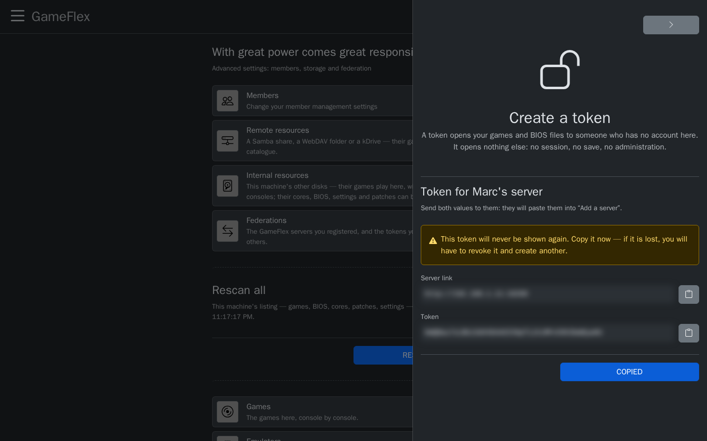

# Share with friends: federation

**Goal:** connect your GameFlex server with a friend's, so that each of you sees the other's
games, BIOS files, emulators, patches and emulator settings, copies what they need, and can play
on the other's server.

## How it works

- **Access goes through a token**, a long key that an administrator creates for one person. A token
  opens **only the catalog**: games, BIOS files, emulators, patches, emulator settings, and, if you
  choose, your Remote Play consoles. It opens no game session, no save and no administration.
- **Each side decides.** Your friend sees your catalog once you give them a token; you see theirs
  once they give you one. You can revoke a token at any time.
- **Nothing is replaced.** What you copy from a friend lands in your own library, and never over a
  file you already have.
- **Each administrator answers for what they share** and for what they take. See the
  [disclaimer](../DISCLAIMER.md).

**Before you start:**

- You are an administrator of your GameFlex.
- Your friend's server can be reached from yours: on the same network, or on the Internet behind
  an HTTPS proxy. To play on their server, the device you play on reaches it too, like any player
  away from home (see [Play away from home](remote-access.md)).

## Give a friend access to your server

1. Open GameFlex through the address your friend will use to reach it (its public HTTPS address,
   see [Play away from home](remote-access.md)): the **Server link** GameFlex gives is the address
   you opened. Then, in **Settings › Federations**, press **Generate a federation token**.
2. In **Who is it for?**, give a name you will recognize, such as *Marc's server*. It is shown next
   to your games on their side, and lets you cut off this access alone.
3. To also show them your Remote Play consoles, tick **Also share the consoles**.
4. Press **Create token**.

   

5. GameFlex shows a **Server link** and a **Token**. Send both to your friend, in a private message.
   **The token is shown only once:** if it is lost, revoke it and create another.

   

## Add a friend's server

1. Ask your friend for their server link and a token (the steps above, on their side).
2. In **Settings › Federations**, press **Add a server**.
3. Fill in a **Display name**, the **URL** they gave you, and the **Access token**.
4. Press **Save**. GameFlex checks the link and the token right away: their server joins the list,
   with its processor, memory and graphics card.

   

## Use their catalog

**Their games.** On the games page of a console, choose their server in **Source**. Their games are
listed, and each one can be:

- **copied to your server:** in **Settings › Games**, choose their server as the source, then press
  the download button next to the game. It lands in your `roms/<console>/`, and plays here like your
  own games;
- **played on their server**, which streams it to you: see
  [Play on a friend's server](#play-on-a-friends-server).

**Their emulators, BIOS files, patches and settings.** In **Settings › Emulators**, **Firmware**,
**Patches** or **Emulator settings**, choose their server as the **Source**, then download what you
need. Emulator settings are imported as a preset of your own (see
[Emulator settings](emulator-settings.md)).

**The phone app** adds a server the same way, and installs the recent consoles' emulators from it
(see [GameFlex on Android](android.md)).

## Play on a friend's server

The game runs on your friend's machine, which streams it to you. It runs under **your account on
their server**: you need one there, and its token. You paste that token once per server; each
member of your GameFlex who wants to play there needs their own account over there.

**On your friend's side:**

1. In **Settings › Members**, they create an account for you, with the consoles you may play.
2. In that account, under **Account token**, they choose a **Duration** and press
   **Enable the token**.

   

**On your side:**

3. Sign in on your friend's GameFlex page with that account. In **Settings › Profile**, under
   **My token**, copy the **Token**.

   

4. Back on your own GameFlex, open one of their games (their server chosen in **Source**). Under
   **Play at <their server>**, paste the token and press **Use this token**.

   

5. The panel now says which account you play under over there. Press **Play**.

   

The game starts on their server and plays in your page, like any other game:

The token stays with your account here, on all your devices: every game of that server now starts
with **Play**. To play there under another account, press **Forget my token** in a game's panel.

## What you should see

- Their server appears in **Settings › Federations**, and in the **Source** lists.
- Their games show under their console, with their server's name.

GameFlex keeps a copy of their list. When they add games, press the refresh button next to
**Source** to fetch the new list.

## Stop sharing

- **Cut off a friend:** in **Settings › Federations**, find their token and press **Revoke**. Their
  server immediately loses access to yours.
- **Stop a friend playing on your server:** in **Settings › Members**, open their account and press
  **Disable the token**. The games they opened with it stop at once.
- **Remove a friend's server:** delete it from **Settings › Federations**. What you copied from it
  stays in your library.

## If something goes wrong

| What you see | What to check |
|---|---|
| *This address did not answer* | The URL, and that their server is reachable from yours (HTTPS proxy, firewall). |
| Their server refuses your token | The token was revoked or mistyped: ask for a new one. |
| **Play at <their server>** refuses your account token | It was disabled, expired or regenerated: ask your friend to enable it again, then copy it from **Settings › Profile** on their GameFlex. |
| A game is listed but unavailable there | Your account on their server has no access to this console: they can grant it in **Settings › Members**. |
| A download says the file already exists | You already have one: delete yours first to take theirs. |
