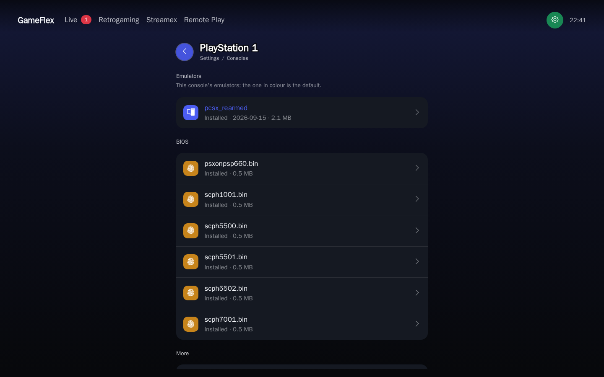
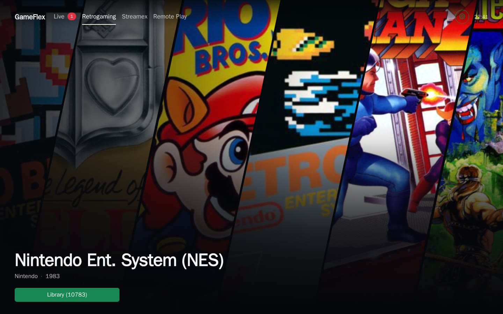

# Organize your library

**Goal:** put your games, BIOS files and emulators where GameFlex finds them.

**Before you start:**

- GameFlex is installed and you can sign in as an administrator.
- You know where your **library folder** is: the folder you gave GameFlex at installation
  (`GAMEFLEX_LIBRARY` in `.env`).
- You have your games and, for the consoles that need them, your BIOS files. GameFlex does not
  provide any.

## The rule in one sentence

**Each console has its own sub-folder, named after the console's ID.** A PlayStation game goes in
`roms/ps1/`, its BIOS in `bios/ps1/`. The IDs are listed in [Consoles](consoles.md).

```
<your library folder>/
├── roms/<console>/      your games
├── bios/<console>/      the BIOS and firmware files some consoles need
├── cores/<console>/     the emulators
├── patches/<console>/   game patches and packs (optional)
├── params/<console>/    emulator settings (managed from GameFlex)
├── metadata/<console>/  game sheets and images, console background images
└── saves/  databases/  status/  logs/  cache/
                         written by GameFlex: leave them alone
```

GameFlex creates these folders as it needs them. You only fill `roms/` and `bios/`, and sometimes
`cores/` and `patches/`.

## Steps

### 1. Add your games

Put each game in the folder of its console: `roms/<console>/`.

A game can be **a single file** or **a folder**:

- **A single file** is the usual case: `roms/snes/Super Mario World.sfc`.
- **A folder** holds a game made of several files, such as a CD image with its tracks
  (`.cue` + `.bin`). The folder's name becomes the game's title:

  ```
  roms/ps1/Final Fantasy VII/
  ├── Final Fantasy VII (Disc 1).cue
  ├── Final Fantasy VII (Disc 1).bin
  ├── …
  └── Final Fantasy VII.m3u
  ```

- **A game on several discs** goes in one folder with a `.m3u` playlist that lists the discs, one
  file name per line. You can then change discs from the game menu.
- **A `.zip` archive** works when it contains a single game file.

Only one level of folder is read: don't put a game folder inside another folder.

The formats each console accepts are listed in [Consoles](consoles.md).

> **Choose your names before you play.** GameFlex recognizes a game by its file or folder name.
> If you rename it later, it becomes a new game: its history and saves stay with the old name.

Your games don't all fit on one disk? Other disks can hold games too: see
[Storage](storage.md#more-disks-of-games).

### 2. Add the BIOS files your consoles need

Most retro consoles need no BIOS. The ones that do look for **exact file names**, in
`bios/<console>/`. For example, for the PlayStation:

```
bios/ps1/scph5500.bin      Japan
bios/ps1/scph5501.bin      North America
bios/ps1/scph5502.bin      Europe
```

[Consoles](consoles.md) gives the names for every console. In GameFlex, **Settings › Consoles**,
then the console, lists under **BIOS** the files it has; a console without one says *This console
needs no BIOS*.

You can find BIOS and firmware files on [RetroBIOS](https://abdess.github.io/retrobios/). RetroBIOS sorts its files for other programs: take them from
its RetroArch pack, then put each one in `bios/<console>/` under the name listed in
[Consoles](consoles.md). For example, RetroArch keeps the Dreamcast files in `dc/`; GameFlex wants
them in `bios/dreamcast/`.

Two emulators read a folder named after themselves instead of a console ID. Create it by hand if
you play these consoles:

```
bios/PPSSPP/ppge_atlas.zim      PSP: the text of system dialogs
bios/PPSSPP/ppge_atlas.meta     (both files come from the PPSSPP "assets" folder)
bios/dolphin-emu/Sys/…          GameCube and Wii: the whole "Sys" folder of Dolphin
```

The Wii shows nothing without `dolphin-emu/Sys/`.

A BIOS can also come from a federated server that lends it: open it in the console's **BIOS**
list, then **Get it** (see below).

### 3. Get the emulators



Open **Settings › Consoles**, then the console. Its page lists:

- **Console enabled**: turned off, nobody launches this console on your server, members and friends
  alike; its **Play** button says **Console disabled** until you turn it back on;
- **Emulators**: the ones on this server, and the ones the console expects but does not have yet,
  marked *Not installed*. The one in colour is the one its games use. A recent console also lists
  the *Phone emulator* packages, which the Android app downloads from this server;
- **BIOS**: its BIOS files, the same way;
- **More**: its games, its emulator settings, its images and its status.

**To download an emulator**, open its line, then choose a source under **Get it**:

- **Official source**: for a retro console, the core from the
  [libretro buildbot](https://buildbot.libretro.com/); for a recent console (PlayStation 3 to 5,
  Switch, Wii U, Xbox, Xbox 360), the console's streamex package, from the
  [gameflex-streamex](https://github.com/zinosaure/gameflex-streamex) releases: the version tested
  with your version of GameFlex, checked against its published fingerprint before it is installed;
- **a federated server** that has it (see [Federation](federation.md)). A server that does not have
  it is greyed out, with the reason.

GameFlex confirms, then downloads it into `cores/<console>/` in the background: the line shows its
progress, and **Cancel** stops it.

**To add an emulator by hand:**

- **A retro core:** take it from the buildbot's
  [Linux x86-64 folder](https://buildbot.libretro.com/nightly/linux/x86_64/latest/), unzip it, and
  put the `.so` file in `cores/<console>/` (for example `cores/snes/snes9x_libretro.so`). A core
  used by two consoles goes in both folders: `dolphin_libretro.so` in `cores/gc/` and `cores/wii/`.
- **A recent console's emulator:** the file its publisher releases, as it is, in
  `cores/<console>/`. GameFlex unpacks it each time a game starts. Take it from the
  emulator's own website ([Consoles](consoles.md)
  links to each one). Take the same variant as the tested version, and give the file a name like
  the one GameFlex shows: it recognizes its files by name. Xenia, for one, publishes
  `xenia_canary_linux.AppImage`: rename it `xenia_canary_linux-<commit>.AppImage`.

**Choose the one in use.** Open an installed emulator:

- on a recent console, **Use this version** makes it the version its games start with, when
  `cores/<console>/` holds several;
- on a retro console with several emulators, **Default emulator** makes it the one its games use.
  A game's settings (the wrench on its page) can still pick another one for a launch.

Without a choice, a recent console starts the file added last, and a retro console its first
emulator. **Danger › Delete this emulator** removes the file from the server. A version other than
the tested one may work less well.

GameFlex never replaces a file that is already there.

### 4. Tell GameFlex to look

GameFlex keeps a list of what your library holds. After you copy files by hand, refresh it:

- **Settings › Rescan everything** refreshes everything;
- **Settings › Resources**, then a disk, **Rescan the disk** refreshes one disk.

## Say which games play

Every game shows a status on its page: **Playable**, **Playable with a patch** (it needs the
settings of its patch), **Graphical glitches** (it plays, with faults in the picture), **Crashes in game**, **Not playable** or **Untested**, the default. An administrator sets it:

- **for a whole console:** **Settings › Consoles**, the console, **Console status**. Every game of
  that console takes it, games added later included, except the ones with a status of their own;
- **for one game:** **Settings › Consoles**, the console, **Games**, its source, the game, then
  **Fix the information**: choose its status for each emulator and, if you like, add a **Note**
  such as *crashes in chapter 2*. Its **History** keeps every report with the emulator's version at
  that time; touch a report to delete it, and the status follows the ones left. From the game's
  page in the library, **More › Edit the game's page** opens this page directly, and **See its page
  in the library** takes you back.

Players see the status on the game's page, with the note of its latest report under it, and in the
catalog's filters. Friends who federate with
your server see your statuses too: they tell them what plays on your machine.

## Browse the catalog and keep favorites

**Settings › Games** lists every game GameFlex can reach: the ones of this server (its library and
its internal disks) and the ones your federated servers lend. Every account sees it, whatever its
role, even one that cannot launch a console.

- **Search** a game by its name, and open the **filters** next to the search bar: only your
  favorites, the sources (this library, each disk, each federated server), the status, a minimum
  size, and the consoles.
- **Open a game** to read its information, then use its **Download** section:
  - **Download the game**: your browser downloads it, like any file. In the Android app, the
    download opens in the phone's browser. Nothing is added to the library;
  - **Download its metadata**: its `metadata/<console>/<game id>/` folder (information and
    images) in a `.zip` archive. Unzipped at the root of a GameFlex folder, it puts the folder back
    in its place. A game shows its metadata once its sheet has been opened at least once.
- Its **More** section holds the rest:
  - **See its sheet in the library**, to play it;
  - **See its saves**: the game's page in **My saves** (see [Storage](storage.md#my-saves)), on
    this server, or at its federated server under your account there. The line is greyed out, with
    the reason, when the game has no save yet or when you have not signed in at that server;
  - **Add to my favorites** or **Remove from my favorites**.
- **Favorites** belong to your account: they follow you on every device. You can also add or remove
  one from a game's settings (the wrench on its page, section **More**).
- **Settings › Profile › My favorites** lists them, a federated server's games included. A favorite
  opens the same page as in the catalog. When its game is gone (removed from its source, its
  console removed, or its server no longer federated), the list says so, and its page lets you
  remove it.
- **Live** (the GameFlex name, at the top) shows them too, under the live games, ten per page: a favorite opens its
  game's page in the library, ready to play; one whose game is gone opens its page in
  **My favorites**.

A game of a federated server comes from that server: its file and its metadata are read there and
passed to your browser, and nothing is copied here. A server running an older GameFlex version
does not lend metadata archives yet.

## What you should see

- **Retrogaming** and **Streamex**, the tabs at the top, show each console with games;
  **Library (N)** opens its games.
- In **Settings › Consoles**, each console lists the emulators and BIOS files you added.



## If something is missing

| What you see | What to check |
|---|---|
| A game does not appear | It is in `roms/<console>/` with the right console ID, in a format the console accepts ([Consoles](consoles.md)), and not in a sub-folder of a sub-folder. Then refresh (step 4). |
| A console does not appear in its tab | It has no game yet: consoles without games are hidden. **Settings › Application › Show consoles with no games** shows them. |
| A game appears twice | The same game is there both as a file and as a folder. Keep one. |
| A file name starts with a dot | Hidden files are ignored. |
| A game starts on a black or frozen screen | Check its BIOS: the right file name, and the right region. Some games also just wait for a button press. |
| A console says its firmware is required | Its BIOS or firmware file is missing or misnamed. [Consoles](consoles.md) gives the expected names. |

## More about the other folders

- **`patches/<console>/`** holds game patches and packs, usually one folder per game. For example,
  Wii U graphic packs: `patches/wiiu/<pack name>/rules.txt`. A game's patch is also on its page in
  **Settings › Consoles**, the console, **Games**, then **Patch**: download it from a source that
  has it, or delete it.
- **`params/<console>/`** holds emulator settings. Change them from **Settings › Consoles**, the
  console, then its emulator's settings, rather than by hand: see
  [Emulator settings](emulator-settings.md).
- **`metadata/<console>/`** holds each game's sheet and images, and the console's background
  images (`background/01` to `08`). GameFlex fills it from your metadata providers
  (**Settings › Metadata provider**); an image dropped there by hand under the same name takes the
  place of the one it replaces.
- **`status/`** holds the status of your games, one file per console. Change it from GameFlex
  rather than by hand (see [Say which games play](#say-which-games-play)).
- **`saves/`**, **`databases/`**, **`logs/`** and **`cache/`** belong to GameFlex. Back them up,
  but don't edit them. **Settings › Cache** shows what the cache holds and lets you clear it.
