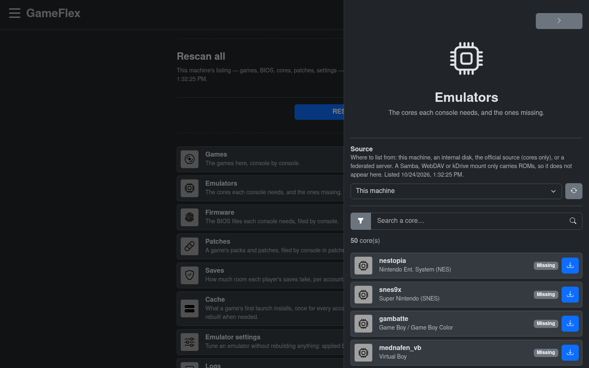

# Organize your library

**Goal:** put your games, BIOS files and emulators where GameFlex finds them.

**Before you start:**

- GameFlex is installed and you can sign in as an administrator.
- You know where your **library folder** is: the folder you gave GameFlex at installation
  (`GAMEFLEX_LIBRARY` in `.env`).
- You have your games and, for the consoles that need them, your BIOS files. GameFlex does not
  provide any.

## The rule in one sentence

**Each console has its own sub-folder, named after the console's ID.** A PlayStation game goes in
`roms/ps1/`, its BIOS in `bios/ps1/`. The IDs are listed in [Consoles](consoles.md).

```
<your library folder>/
├── roms/<console>/      your games
├── bios/<console>/      the BIOS and firmware files some consoles need
├── cores/<console>/     the emulators
├── patches/<console>/   game patches and packs (optional)
├── params/<console>/    emulator settings (managed from GameFlex)
└── saves/  databases/  logs/  cache/
                         written by GameFlex: leave them alone
```

GameFlex creates all these folders when it starts. You only fill `roms/` and `bios/`, and sometimes
`cores/` and `patches/`.

## Steps

### 1. Add your games

Put each game in the folder of its console: `roms/<console>/`.

A game can be **a single file** or **a folder**:

- **A single file** is the usual case: `roms/snes/Super Mario World.sfc`.
- **A folder** holds a game made of several files, such as a CD image with its tracks
  (`.cue` + `.bin`). The folder's name becomes the game's title:

  ```
  roms/ps1/Final Fantasy VII/
  ├── Final Fantasy VII (Disc 1).cue
  ├── Final Fantasy VII (Disc 1).bin
  ├── …
  └── Final Fantasy VII.m3u
  ```

- **A game on several discs** goes in one folder with a `.m3u` playlist that lists the discs, one
  file name per line. You can then change discs from the in-game menu.
- **A `.zip` archive** works when it contains a single game file.

Only one level of folder is read: don't put a game folder inside another folder.

The formats each console accepts are listed in [Consoles](consoles.md).

> **Choose your names before you play.** GameFlex recognizes a game by its file or folder name.
> If you rename it later, it becomes a new game: its favorites, history and saves stay with the old
> name.

### 2. Add the BIOS files your consoles need

Most retro consoles need no BIOS. The ones that do look for **exact file names**, in
`bios/<console>/`. For example, for the PlayStation:

```
bios/ps1/scph5500.bin      Japan
bios/ps1/scph5501.bin      North America
bios/ps1/scph5502.bin      Europe
```

[Consoles](consoles.md) gives the names for every console. In GameFlex, **Settings › Firmware**
shows which files each console needs and which are missing.

You can find BIOS and firmware files on [RetroBIOS](https://abdess.github.io/retrobios/), or on
the [mirror](../README.md#the-mirror). RetroBIOS sorts its files for other programs: take them from
its RetroArch pack, then put each one in `bios/<console>/` under the name listed in
[Consoles](consoles.md). For example, RetroArch keeps the Dreamcast files in `dc/`; GameFlex wants
them in `bios/dreamcast/`.

Two emulators read a folder named after themselves instead of a console ID. Create it by hand if
you play these consoles:

```
bios/PPSSPP/ppge_atlas.zim      PSP: the text of system dialogs
bios/PPSSPP/ppge_atlas.meta     (both files come from the PPSSPP "assets" folder)
bios/dolphin-emu/Sys/…          GameCube and Wii: the whole "Sys" folder of Dolphin
```

The Wii shows nothing without `dolphin-emu/Sys/`.

### 3. Get the emulators



**Retro consoles** use libretro cores. In **Settings › Emulators**, keep the source on
**This machine**, find the core marked *missing*, and press the download button. GameFlex downloads
it from the [libretro buildbot](https://buildbot.libretro.com/) and files it in
`cores/<console>/`.

To add a core by hand, take it from the buildbot's
[Linux x86-64 folder](https://buildbot.libretro.com/nightly/linux/x86_64/latest/), unzip it, and
put the `.so` file in `cores/<console>/` (for example `cores/snes/snes9x_libretro.so`). A core used
by two consoles goes in both folders: `dolphin_libretro.so` in `cores/gc/` and `cores/wii/`.

**Recent consoles** (PlayStation 3 to 5, Switch, Wii U, Xbox, Xbox 360) use a full emulator: the
file its publisher releases, as it is, in `cores/<console>/`. GameFlex unpacks it each time a game
starts. You can get it:

- from **Settings › Emulators**: keep the source on **This machine**, find the emulator marked
  *missing*, and press the download button. GameFlex downloads the version tested with your
  version of GameFlex from the emulator's publisher;
- from a **friend's GameFlex server**: in **Settings › Emulators**, choose their server as the
  source, then download;
- from the [mirror](../README.md#the-mirror), then copy it into `cores/<console>/`;
- from the emulator's own website. [Consoles](consoles.md) links to each one. Take the same
  variant as the tested version, and give the file a name like the one **Settings › Emulators**
  shows: GameFlex recognizes its files by name. Xenia, for one, publishes
  `xenia_canary_linux.AppImage`: rename it `xenia_canary_linux-<commit>.AppImage`.

**The last one you add is the one used.** `cores/<console>/` can hold several versions of an
emulator: a game starts with the one whose file is the most recent, normally the last one you
added (a copy that keeps the original date, such as `cp -p`, does not count as new). To go back to
an earlier version, delete the newer one from **Settings › Emulators**. A version other than the tested one may work less well.

GameFlex never replaces a file that is already there.

### 4. Tell GameFlex to look

GameFlex keeps a list of what your library holds. After you copy files by hand, refresh it:

- **Settings › Rescan all** refreshes everything;
- or press the refresh button next to the **Source** list, on the Games, Emulators and Firmware
  screens: it refreshes that section only.

## What you should see

- The **Games** page lists your games under their console.
- In **Settings › Firmware** and **Settings › Emulators**, the files you added are ticked.

## If something is missing

| What you see | What to check |
|---|---|
| A game does not appear | It is in `roms/<console>/` with the right console ID, in a format the console accepts ([Consoles](consoles.md)), and not in a sub-folder of a sub-folder. Then refresh (step 4). |
| A game appears twice | The same game is there both as a file and as a folder. Keep one. |
| A file name starts with a dot | Hidden files are ignored. |
| A game starts on a black or frozen screen | Check its BIOS: the right file name, and the right region. Some games also just wait for a button press. |
| A console says its firmware is required | Its BIOS or firmware file is missing or misnamed. **Settings › Firmware** shows the expected names. |

## More about the other folders

- **`patches/<console>/`** holds game patches and packs, usually one folder per game. For example,
  Wii U graphic packs: `patches/wiiu/<pack name>/rules.txt`.
- **`params/<console>/`** holds emulator settings. Change them from **Settings › Emulator settings**
  rather than by hand: see [Emulator settings](emulator-settings.md).
- **`saves/`**, **`databases/`**, **`logs/`** and **`cache/`** belong to GameFlex. Back them up,
  but don't edit them. **Settings › Cache** shows what the cache holds and lets you clear it.
